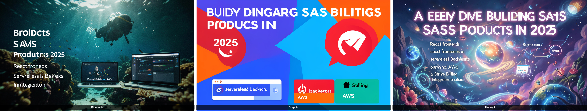

# Zero to Working Pipeline: Build an AI Thumbnail Generator with FLUX.2

**Automate a 2-hour design workflow into a single CLI command — one API key, zero LLM dependencies.**

> You have a video script. You need three thumbnail options. You open Figma, fight with stock photos, tweak Canva templates, export, compare, repeat. That's 1–2 hours of creative friction *per video*.
>
> By the end of this tutorial, you'll type one command and get three production-quality thumbnail concepts in under 30 seconds — generated from your actual video content. Want yourself in the thumbnails? Pass a headshot.

> Working repo: [github.com/MaanavD/bfl-thumbnail-generator](https://github.com/MaanavD/bfl-thumbnail-generator) (private for now; make it public before sharing this tutorial externally).

### What You'll Build

This tutorial ships **two artifacts** that demonstrate the full arc from API integration to production automation:

| Artifact | What it does | What it teaches |
|----------|--------------|------------------|
| **`thumbnail-generator/`** | CLI tool — type a description, get 3 thumbnails | BFL FLUX.2 API, async polling, prompt templating, image compositing with sharp |
| **`pipeline/`** | Express server — auto-generates and sets thumbnails when you publish a YouTube video | YouTube Pub/Sub webhooks, Data API integration, serverless-ready architecture |

The first is the foundation. The second is where it goes in production.

---

## Who This Is For

Developers who ship. You're comfortable with Node.js, you've used APIs before, and you don't need hand-holding on `npm install`.

**Prerequisites:**
- Node.js 20+
- A BFL API key ([dashboard.bfl.ai](https://dashboard.bfl.ai/) — $10 in credits is plenty)

That's it. One API key. No secondary LLM service, no prompt engineering degree.

---

## The Architecture

This is a pipeline — a single Node.js script that takes your video description, wraps it in three visual style templates, and sends them to FLUX.2. Optionally, pass a headshot and FLUX.2's multi-reference editing puts *you* in every thumbnail with character consistency.

```
                                     +----------------------------+
+----------------+    +-----------+  |   BFL FLUX.2 API           |
| CLI Input      |    | Prompt    |  |   flux-2-klein-4b          |
|                |--->| Builder   |->|                            |
| description    |    |           |  |   3 concurrent requests    |
| + [headshot]   |    | 3 style   |  |   (+ face if provided)     |
+----------------+    | templates |  +-----------+----------------+
                      +-----------+              |
                                    +------------v---------------+
                                    |   sharp (compositing)      |
                                    |   3 individual PNGs        |
                                    |   + comparison grid        |
                                    +------------+---------------+
                                                 |
                                    +------------v---------------+
                                    |   HTML Viewer (local file) |
                                    |   Compare all 3 - Copy     |
                                    +----------------------------+
```

### Why No LLM for Prompts?

You might expect an LLM to generate the image prompts. We skip that entirely. Here's why:

1. **You already know your content.** A video title is weak signal. A paragraph you write about your actual video -- the thesis, the vibe, the key visuals — is far richer than anything an LLM will extrapolate from a title string.
2. **Deterministic beats random.** LLM prompt generation is non-deterministic. Our template system gives you the same 3 style variations every time, wrapping *your* description in proven visual frameworks.
3. **One fewer API key.** One fewer billing dashboard. One fewer rate limit. One fewer thing that can break at 2am.

### Why FLUX.2?

YouTube thumbnails demand exact compositions — facial expressions, color palettes, object positioning, scene framing. FLUX.2's prompt adherence is what makes this pipeline viable. Previous models fumbled layouts and ignored compositional instructions. FLUX.2 follows them reliably, and the `flux-2-klein-4b` endpoint delivers sub-second inference at \$0.014/image.

When you pass a headshot with `--face`, the same endpoint activates multi-reference editing -- FLUX.2 maintains your facial identity across all three style variations. Same API, same endpoint, one extra parameter.

### Cost Per Run

| Component | Cost |
|-----------|------|
| FLUX.2 × 3 images (1344×768) | ~\$0.04 |
| **Total per run** | **~\$0.04** |

Three professional thumbnail concepts for four cents.

---

## Let's Build It

### Step 1: Clone and Configure (2 minutes)

```bash
git clone git@github.com:MaanavD/bfl-thumbnail-generator.git
cd bfl-thumbnail-generator/thumbnail-generator
npm install
```

The repo root contains this tutorial plus both shipped artifacts:

- `thumbnail-generator/` - the CLI tool you'll build first
- `pipeline/` - the end-to-end YouTube automation server you'll wire up later

Create a `.env` file:

```env
BFL_API_KEY=your_bfl_api_key_here
```

> **Get your BFL API key:** Go to [dashboard.bfl.ai](https://dashboard.bfl.ai/), create an account, add credits (\$5 minimum), navigate to API → Keys, and create a key. You only see the full key once — copy it immediately.

### Step 2: The Prompt Builder — No LLM Required

Instead of calling an LLM, we use style templates that wrap your description. Here's the core of `src/promptGenerator.js`:

```javascript
const STYLE_TEMPLATES = [
  {
    name: "Cinematic",
    wrap: (desc, hasFace) =>
      `A photorealistic, cinematic YouTube thumbnail with dramatic lighting
       and shallow depth of field. ${hasFace ? "The person from the reference
       image is the main subject, " : ""}The scene depicts: ${desc}. Shot on
       35mm film, rich color grading, high contrast, bold composition optimized
       for small-size readability.`,
  },
  // ... Graphic and Abstract templates follow the same pattern
];

export function buildPrompts(description, hasFace = false) {
  return STYLE_TEMPLATES.map((style) => style.wrap(description, hasFace));
}
```

Each template targets a distinct visual style — Cinematic, Graphic, Abstract — and when a face reference is provided, the templates instruct FLUX.2 to feature "the person from the reference image" as the subject.

You write the description. The templates handle the visual direction. FLUX.2 handles the rest.

### Step 3: Hitting the FLUX.2 Endpoint

The image generator in `src/imageGenerator.js` submits requests to BFL's API. Here's the core of it:

```javascript
const FLUX_ENDPOINT = "https://api.bfl.ai/v1/flux-2-klein-4b";

// Build the request payload
const payload = {
  prompt,
  width: 1344,
  height: 768,
};

// If a face reference is provided, use multi-reference editing
if (faceBase64) {
  payload.input_image = faceBase64;
}

// Submit the request
const response = await fetch(FLUX_ENDPOINT, {
  method: "POST",
  headers: {
    "Content-Type": "application/json",
    "x-key": BFL_API_KEY,
  },
  body: JSON.stringify(payload),
});

const { polling_url } = await response.json();
```

Notice the elegance: the *same endpoint* handles both text-to-image and multi-reference editing. When `input_image` is present, FLUX.2 activates character consistency automatically. When it's absent, pure text-to-image. No endpoint switching, no separate API calls.

### Step 4: The Polling Pattern

BFL uses async generation — you submit, then poll. Simple loop:

```javascript
for (let poll = 0; poll < MAX_POLLS; poll++) {
  await sleep(1000);

  const pollResponse = await fetch(polling_url, {
    headers: { "x-key": BFL_API_KEY },
  });
  const result = await pollResponse.json();

  if (result.status === "Ready") {
    // Download the image from result.result.sample (a signed URL)
    const image = await fetch(result.result.sample);
    return Buffer.from(await image.arrayBuffer());
  }
}
```

We run all 3 generations concurrently with `Promise.all`, so the total wait is the time for the *slowest* image — not three sequential waits.

### Tip: Getting a Good Description Without Writing One

The pipeline runs on a description — but you don't have to write it from scratch. The best thumbnails come from rich, specific descriptions of your video's content. Here are three ways to get one with minimal effort, starting with the easiest.

**Option A: YouTube's AI Summary (recommended — free, zero setup)**

YouTube has a built-in "Ask about this video" feature powered by Gemini. Click the sparkle icon below any video and hit **"Summarize the video"**. You'll get a structured breakdown like this:

```
This video breaks down the major upgrades in FLUX.2, the new text-to-image
model from Black Forest Labs, and how to adapt your workflow for best results.

Key Enhancements:
• New Architecture: FLUX.2 is a brand new model, not just a fine-tune,
  utilizing a language-model approach for deeper semantic understanding.
• Performance: It offers faster inference (rendering up to 10x faster)
  and supports high-resolution 2K output.
• Prompt Adherence: The model now interprets complex, nuanced instructions
  more literally, allowing for the combination of opposing styles.
```

Copy that summary, paste it into a text file, and feed it to the generator:

```bash
node src/index.js --file youtube-summary.txt --face headshot.jpg
```

This is the sweet spot: YouTube already watched your video, extracted the key themes, and structured them — for free, on any account. The summary gives FLUX.2 exactly the kind of rich, specific context it needs to generate relevant thumbnails.

**Option B: Whisper (local, free, no API key)**

If your video isn't on YouTube yet, OpenAI's [Whisper](https://github.com/openai/whisper) runs entirely on your machine. Install it, point it at your video, and pipe the output straight into the generator:

```bash
# Transcribe your video locally
whisper my-video.mp4 --model base --output_format txt

# Feed the transcript to the thumbnail generator
node src/index.js --file my-video.txt --face headshot.jpg
```

The `base` model runs on CPU in seconds for a 10-minute video. You don't need a perfect transcript — you need the *gist*, and Whisper delivers that reliably.

**Option C: Just talk into your mic**

No video yet? Open a voice memo app, spend 30 seconds describing what your video is about — the topic, the vibe, the key takeaway — and transcribe that with Whisper. A spoken, rambling paragraph produces better thumbnails than a polished three-word title because it gives FLUX.2 more visual material to work with.

The point: **don't overthink the input.** A YouTube AI summary, a rough transcript, or a stream-of-consciousness voice note will all outperform a carefully crafted title, because more context means more visual specificity in the generated thumbnails.

### Step 5: Run It

**Basic — text-to-image from a description:**

```bash
node src/index.js "A deep dive into building SaaS products in 2025. We cover the full stack — React frontend, serverless backend on AWS, Stripe billing integration, and why most indie hackers fail at distribution not engineering."
```

**With a face — put yourself in the thumbnails:**

```bash
node src/index.js "A deep dive into building SaaS products in 2025" --face headshot.jpg
```

**From a file — for longer descriptions or full script excerpts:**

```bash
node src/index.js --file video-description.txt --face headshot.jpg
```

You'll see:

```
Generating thumbnails for:
   "A deep dive into building SaaS products in 2025..."

Face reference: headshot.jpg

Built 3 prompts from templates (0.0s)
Sending 3 prompts to FLUX.2 API...
   (with face reference for character consistency)
Polling for results...

Image 1 ready — downloading...
Image 2 ready — downloading...
Image 3 ready — downloading...

All 3 images generated (8.2s)
Building comparison grid...

Done in 8.4s! Output saved to output/
```

Open `viewer.html` in your browser. Three distinct thumbnails — and if you used `--face`, *you're in all of them*.

### What a Real Run Produces

This repo includes committed example outputs in `examples/` so anyone opening the repository can immediately see what the generator produces without spending credits first.

These files were generated from this exact command:

```bash
node src/index.js "A deep dive into building SaaS products in 2025, covering React frontends, serverless backends on AWS, and Stripe billing integration"
```

Generated artifacts:

```text
thumbnail-generator/output/
├── comparison.png
├── metadata.json
├── thumbnail_1.png
├── thumbnail_2.png
└── thumbnail_3.png

examples/
├── cli-comparison.png
├── cli-cinematic.png
├── cli-graphic.png
└── cli-abstract.png
```

Committed showcase grid:



The corresponding `metadata.json` captures the exact description, styles, and prompts used for the run:

```json
{
  "description": "A deep dive into building SaaS products in 2025, covering React frontends, serverless backends on AWS, and Stripe billing integration",
  "face": null,
  "generated_at": "2026-03-28T17:54:22.846Z",
  "styles": ["Cinematic", "Graphic", "Abstract"]
}
```

That means the artifact is not just a demo script. It produces a reusable package of outputs you can inspect, compare, archive, or feed into a downstream approval flow.

### Step 6: Iterate

```bash
# Different content, same face
node src/index.js "Why Rust is eating Python's lunch in systems programming" --face headshot.jpg

# No face, pure concept art
node src/index.js "The hidden costs of microservices — why monoliths are making a comeback"

# Long-form description from a file
node src/index.js --file script-excerpt.txt
```

Each run overwrites `output/` with fresh results. Total turnaround: under 10 seconds.

---

## Scaling and Ecosystem

This tutorial uses the **BFL API** directly — one key, zero infrastructure. But the FLUX ecosystem gives you options as you scale:

**Third-Party Platforms:** Providers like Replicate and Fal host FLUX models with their own scaling infrastructure. Swapping endpoints is often the only change needed — the request/response contract is functionally identical.

**Self-Hosted Open Weights:** FLUX.2 [klein] 4B is fully open under Apache 2.0, runnable on a single consumer GPU (~13GB VRAM). Wrap a ComfyUI or diffusers instance in an API, point this pipeline at your own metal, and skip per-image costs entirely.

The core logic stays the same regardless of where FLUX runs: **Description in → Style templates → FLUX → Thumbnails out.**

---

## Fitting This Into a Fully Automated Pipeline

A CLI tool is the starting point. The real power unlocks when you remove yourself from the loop entirely. Here's how this thumbnail generator slots into broader automation — from "I uploaded a video" to "thumbnails are live" with zero human interaction.

### End-to-End: Video Publish → Thumbnails Live

Here's the dream workflow: you hit "Publish" on YouTube, walk away, and thumbnails generate and set themselves. This is fully achievable today with a few glue pieces.

**The flow:**

```
YouTube publish
     │
     ▼
Pub/Sub notification (or poll)
     │
     ▼
Cloud Function / Lambda
     │
     ├─ 1. Fetch video description via YouTube Data API
     │
     ├─ 2. buildPrompts(description) → 3 style prompts
     │
     ├─ 3. generateAllImages(prompts) → 3 thumbnails via BFL
     │
     ├─ 4. Upload to storage (S3 / GCS)
     │
     └─ 5. youtube.thumbnails.set() → live on the video
```

Every step here uses APIs we've already covered or standard cloud primitives. The only new piece is detecting the upload — YouTube supports this via [Pub/Sub push notifications](https://developers.google.com/youtube/v3/guides/push_notifications) that fire when your channel's feed updates.

A simplified Cloud Function that wires this together:

```javascript
import { google } from "googleapis";
import { buildPrompts } from "./src/promptGenerator.js";
import { generateAllImages } from "./src/imageGenerator.js";

export async function onVideoPublished(event) {
  const youtube = google.youtube({ version: "v3", auth: oauthClient });

  // 1. Get video details
  const { data } = await youtube.videos.list({
    part: "snippet",
    id: event.videoId,
  });
  const description = data.items[0].snippet.description;

  // 2. Generate thumbnails
  const prompts = buildPrompts(description);
  const images = await generateAllImages(prompts);

  // 3. Set the first option as the thumbnail (or pick based on preference)
  const stream = bufferToStream(images[0]);
  await youtube.thumbnails.set({
    videoId: event.videoId,
    media: { mimeType: "image/png", body: stream },
  });

  console.log(`Thumbnail set for video ${event.videoId}`);
}
```

Want to pick the best thumbnail instead of defaulting to the first? Add a Slack/Discord notification step that posts the comparison grid and lets you tap a button. The function pauses, waits for your selection, then sets that one. Fully automated with an optional human checkpoint.

### Trigger Options

Multiple ways to detect new content and kick off the pipeline:

- **YouTube Pub/Sub** — subscribe to your channel's Atom feed via [push notifications](https://developers.google.com/youtube/v3/guides/push_notifications). YouTube pings your webhook URL when a new video goes live. Zero polling, instant.
- **YouTube Data API polling** — simpler setup. A cron job calls `search.list` every few minutes filtered to your channel. When a new `videoId` appears, fire the pipeline.
- **Cloud storage triggers** — if your workflow drops raw video files into S3 or GCS, a Lambda/Cloud Function fires on the `ObjectCreated` event and extracts metadata (filename, associated description file, etc.).
- **CI/CD webhooks** — a GitHub Actions workflow triggers on a push to a `videos/` directory in a content repo, where each video has a companion `.md` file with the description.
- **Zapier / Make / n8n** — for no-code glue. "When new YouTube video → call webhook" is a one-click trigger on all these platforms, and your webhook points at the Cloud Function above.

The thumbnail generator already accepts a description string and an optional face image — both trivially extracted from any of these sources.

### Orchestration: Serverless or Queued

This pipeline is stateless and fast — perfect for serverless:

```
Upload event → Lambda / Cloud Function → thumbnail-generator → Output to S3
```

A minimal AWS Lambda wrapper looks like this:

```javascript
import { buildPrompts } from "./src/promptGenerator.js";
import { generateAllImages } from "./src/imageGenerator.js";
import { createComparisonGrid } from "./src/gridCompositor.js";
import { S3Client, PutObjectCommand } from "@aws-sdk/client-s3";

export async function handler(event) {
  const { description, faceUrl, videoId } = event;

  const prompts = buildPrompts(description, !!faceUrl);
  const images = await generateAllImages(prompts, faceUrl);
  const grid = await createComparisonGrid(images);

  const s3 = new S3Client({});
  // Upload individual images + grid to S3
  for (let i = 0; i < images.length; i++) {
    await s3.send(new PutObjectCommand({
      Bucket: process.env.OUTPUT_BUCKET,
      Key: `thumbnails/${videoId}/option-${i + 1}.png`,
      Body: images[i],
      ContentType: "image/png",
    }));
  }

  return { statusCode: 200, body: `Generated ${images.length} thumbnails` };
}
```

For higher volumes, drop events onto an SQS queue and process them with a worker. The BFL API handles concurrency on their end — you just need to respect rate limits.

### Auto-Setting Thumbnails via the YouTube API

Once thumbnails land in S3 (or any accessible storage), a downstream step can push them directly to YouTube:

```javascript
// Using googleapis
import { google } from "googleapis";

const youtube = google.youtube({ version: "v3", auth: oauthClient });

await youtube.thumbnails.set({
  videoId: "YOUR_VIDEO_ID",
  media: {
    mimeType: "image/png",
    body: thumbnailStream, // ReadStream of the chosen image
  },
});
```

This closes the loop: video uploaded → thumbnails generated → best option set as the live thumbnail. If you want human approval in the loop, insert a Slack/Discord notification with the comparison grid and a "pick one" button — the automation pauses until someone taps a choice.

### Batch Processing: Backfill Existing Content

Got 200 existing videos with weak thumbnails? Wrap the generator in a simple loop:

```javascript
import { readFileSync } from "fs";

const videos = JSON.parse(readFileSync("videos.json", "utf-8"));

for (const video of videos) {
  console.log(`Generating for: ${video.title}`);
  const prompts = buildPrompts(video.description, !!video.facePath);
  const images = await generateAllImages(prompts, video.facePath);
  // Save or upload...
}
```

At $0.04/video, backfilling 200 videos costs $8. That's less than one stock photo subscription month.

### A/B Testing at Scale

Three style variations per video isn't just convenience — it's an A/B testing machine. Use the YouTube Data API to rotate thumbnails on a schedule and track click-through rate:

1. **Day 1–3:** Set Cinematic as thumbnail, record CTR.
2. **Day 4–6:** Swap to Graphic, record CTR.
3. **Day 7–9:** Swap to Abstract, record CTR.
4. **Day 10+:** Lock in the winner.

This is exactly what top YouTube channels do manually. With this pipeline, you can automate the rotation and let the data decide.

### The Full Picture

```
+------------------+     +-------------------+     +--------------------+
| Content Source   |     | Thumbnail         |     | Distribution       |
|                  |     | Generator         |     |                    |
| YouTube publish  |     |                   |     | YouTube API        |
| YouTube Pub/Sub  |     |                   |     | (auto-set thumb)   |
| S3 file drop     |---->| buildPrompts()    |---->| Slack/Discord      |
| Git push         |     | generateImages()  |     | approval flow      |
| CMS webhook      |     | createGrid()      |     | S3 / CDN storage   |
| Zapier / n8n     |     |                   |     | A/B rotation       |
+------------------+     +-------------------+     +--------------------+
```

The thumbnail generator we built is the middle box. It doesn't care what triggers it or where the output goes — it takes a description, returns images. That's what makes it composable.

You started with a CLI tool that saves you 2 hours per video. Wire it into your content pipeline and it saves you 2 hours per video *without you being there*.

### Run the Pipeline Yourself

The `pipeline/` directory in this repo is a working implementation of everything described above. It's a standalone Express server that handles YouTube Pub/Sub webhooks, fetches video descriptions, generates thumbnails via FLUX.2, and sets them on YouTube — all automatically.

```bash
cd ../pipeline
npm install
cp .env.example .env   # Fill in BFL_API_KEY + Google service account
npm start              # Server on port 3000
```

Trigger it manually for any video:

```bash
# Via CLI
node src/trigger.js VIDEO_ID

# Via HTTP
curl -X POST http://localhost:3000/trigger \
  -H "Content-Type: application/json" \
  -d '{"videoId": "VIDEO_ID"}'
```

And when it runs successfully, the output is intentionally boring in the best way possible:

```text
$ node src/trigger.js vjDtClDSh6o --desc "A cinematic, close-up shot of a gamer's hands on a keyboard and mouse..."

🎬 Pipeline started for video: vjDtClDSh6o
📺 Video: "<your YouTube title>"
📝 Using custom description: "A cinematic, close-up shot of a gamer's hands on a keyboard and mouse..."
🎨 Built 3 style prompts: Cinematic, Graphic, Abstract
⏳ Generating 3 images via FLUX.2...
✅ 3 images generated (8.0s)
📤 Setting "Cinematic" as thumbnail on YouTube...
✅ Thumbnail set for video vjDtClDSh6o
```

If you omit `--desc`, the pipeline pulls the live YouTube description instead and uses that as the source material. That makes the fully automated version genuinely simple: publish the video, let the webhook fire, and let the pipeline do the rest.

Or subscribe to YouTube Pub/Sub and let it run hands-free. See [`pipeline/README.md`](pipeline/README.md) for full setup.